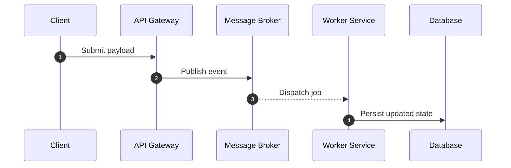
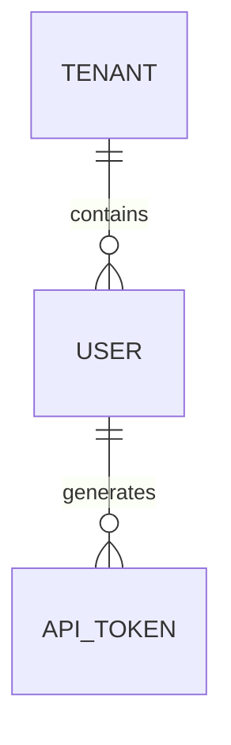

# Engineering Documentation Framework Guide

## 1. Directory Structure

Place these documents directly inside the `docs/project/` directory to ensure they are version-controlled alongside application code:

```text
docs/
└── project/
    ├── 01-project-brief.md
    ├── 02-project-plan.md
    ├── 03-project-requirements.md
    ├── 04-project-specifications.md
    └── 05-project-data.md
```

---

## 2. Document Standards & Formats

### `01-project-brief.md` — The Problem Statement

- **Heading:** Project Brief
- **Description:** Purely document the actual operational, real-world, or business problem the system solves.
- **Rules:** Keep it strictly focused on the problem. Do not add executive summaries, user personas, marketing metrics, or non-goals here.
- **Template:**

```markdown
# Project Brief

## The Problem
[Provide a clear, detailed breakdown of the existing problem, operational pain points, inefficiencies, or system failures that this project exists to resolve.]
```

---

### `02-project-plan.md` — Technical Challenges & Solutions

- **Heading:** Project Plan
- **Description:** Break down the main problem into concrete sub-problems or technical bottlenecks, paired directly with their intended solutions.
- **Rules:** Avoid management/timeline details. Maintain a strict **Problem to Solution** pair format.
- **Template:**

```markdown
# Project Plan

### Challenge 1: [Short Title of Sub-Problem]
- **Problem:** [Describe the technical hurdle, risk, performance bottleneck, or edge case.]
- **Solution:** [Describe the architecture pattern, algorithm, library, or engineering strategy used to solve it.]

### Challenge 2: [Short Title of Sub-Problem]
- **Problem:** [Describe the sub-problem.]
- **Solution:** [Describe the solution.]
```

---

### `03-project-requirements.md` — Labeled Requirements Matrix

- **Heading:** Project Requirements
- **Description:** Provide an exhaustive, testable list of system guarantees and capabilities.
- **Label Convention:** `[TYPE]-[CATEGORY]-[NUMBER]`
  - **`TYPE`**: `FR` (Functional Requirement) or `NFR` (Non-Functional Requirement).
  - **`CATEGORY`**: 3–5 letter tag for the domain/feature area (e.g., `AUTH`, `BILL`, `SYNC`, `PERF`).
  - **`NUMBER`**: Sequential 3-digit counter (`001`, `002`, `003`).
- **Template:**

```markdown
# Project Requirements

## Functional Requirements
- **[FR-AUTH-001]**: The system must revoke all active refresh tokens when a user initiates a password reset.
- **[FR-BILL-001]**: The system must retry failed invoice webhooks up to 5 times using exponential backoff.
- **[FR-SYNC-001]**: The system must detect concurrent mutations and flag conflicting writes for manual resolution.

## Non-Functional Requirements
- **[NFR-PERF-001]**: Feed fetch endpoints must return responses within 150ms at p95 under standard load.
- **[NFR-SEC-001]**: All sensitive data at rest must be encrypted using AES-256-GCM.
```

---

### `04-project-specifications.md` — Numbered Features & Behavioral Flows

- **Heading:** Project Specifications
- **Description:** Detail the concrete functional mechanics, step-by-step logic, and visual flows for every feature so engineers know what to build and how it runs.
- **Rules:** Group features under a numeric hierarchy (`Feature 1.0`, `1.1`, `Feature 2.0`) and include sequence diagrams, state machines, or step-by-step execution trees.
- **Template:**

````markdown
# Project Specifications

## Feature 1.0: [Feature Name]

### 1.1 Overview & Behavior
[Describe the feature scope, state transitions, validation checks, and error-handling steps.]

### 1.2 Execution Flow & Diagrams


---

## Feature 2.0: [Feature Name]

### 2.1 Overview & Behavior
[Describe the feature scope, state transitions, validation checks, and error-handling steps.]
````

---

### `05-project-data.md` — Entities, Relationships & Data Semantics

- **Heading:** Project Data
- **Description:** Specify all domain models, explain how they relate across domains, and document the semantic meaning, business rules, and invariants of system data.
- **Template:**

````markdown
# Project Data

## 1. Domain Entities & Semantic Definitions
- **[EntityName]**: What this entity conceptually represents in the real world (e.g., Tenant represents a billing organization, distinct from an individual User).
  - `field_name`: Meaning, unit of measurement (e.g., UTC unix timestamp in ms, monetary values stored in base currency cents), immutability rules.
  - `status`: Allowed state definitions and what each state functionally implies.

## 2. Entity Relationships
- **[EntityA] to [EntityB]**: Nature of relation (1:1, 1:N, N:M), foreign key or logical reference, cascade behaviors.


## 3. Data Semantics & Invariants
- **Validation Constraints:** Global invariants that must remain true across mutations.
- **Data Lifecycle & Cleanup:** Retention rules, soft-delete mechanisms, and archival criteria.
````

---

## 3. Team Maintenance Rules

1. **Colocated with Code:** Keep these files inside `docs/project/` so they evolve through regular version control.
2. **PR Gatekeeping:** Any pull request modifying an entity, adding a feature, or altering a requirement must update the corresponding doc (`02`, `03`, `04`, or `05`) as part of the same commit.
3. **Scan-Friendly:** Prioritize clear identifiers, explicit bullet points, and visual diagrams over prose blocks so onboarding engineers can understand the architecture in a single sitting.